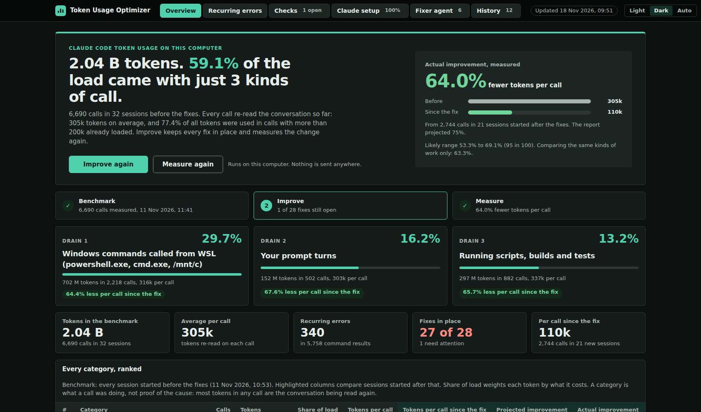
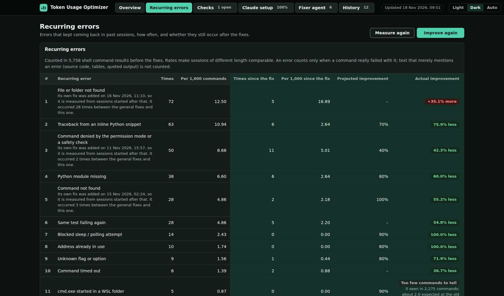
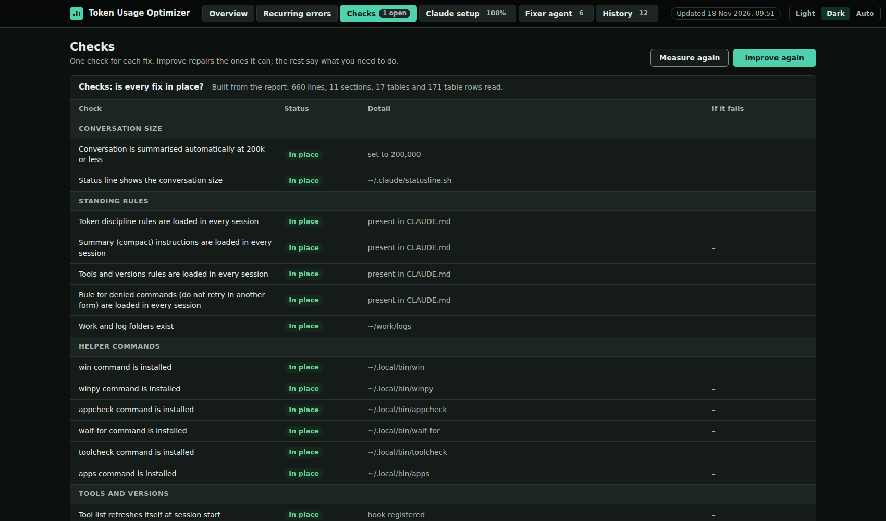
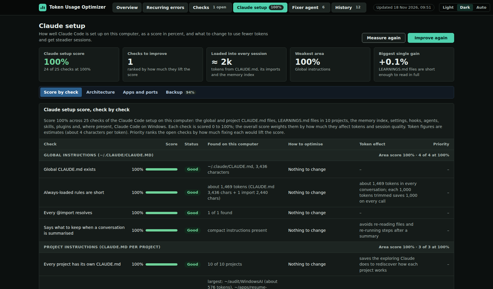
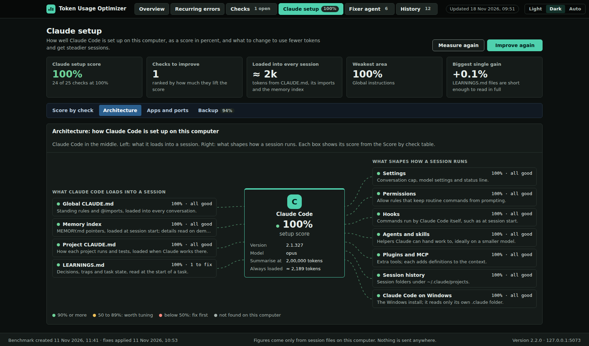
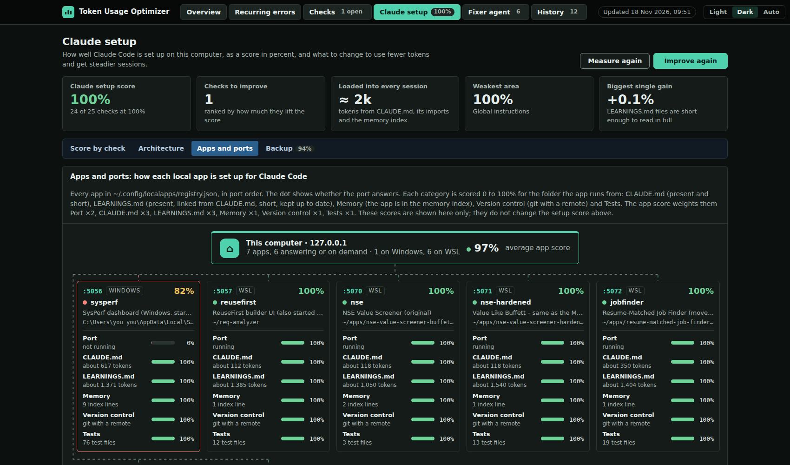
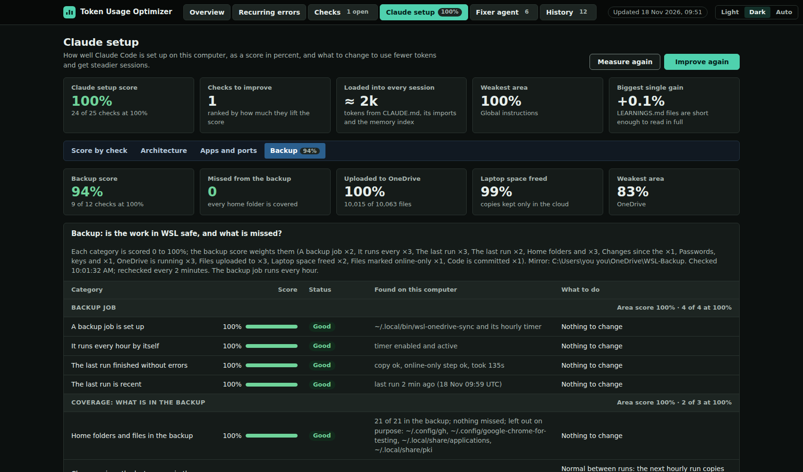
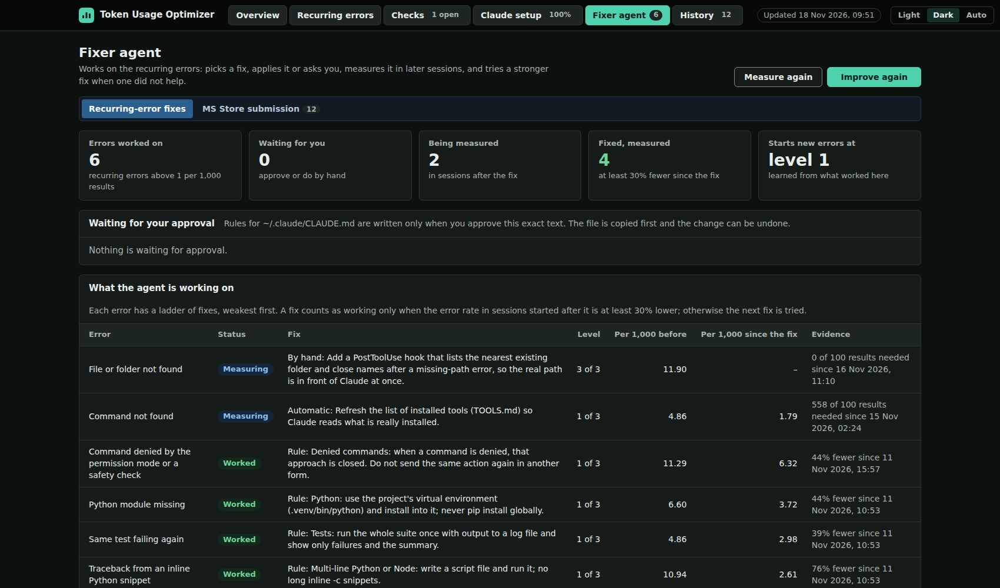
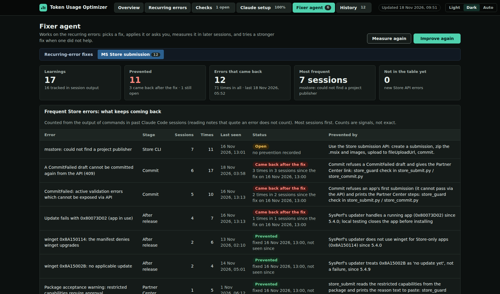
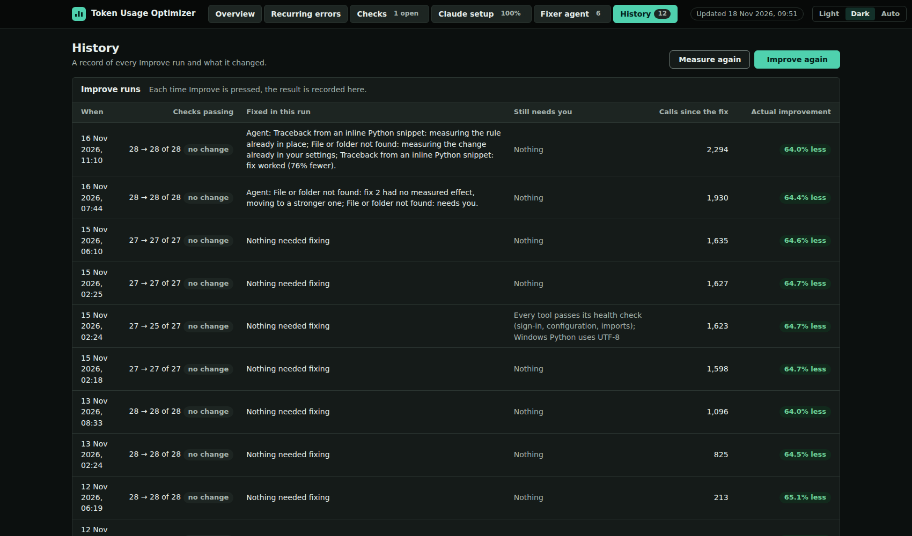

# Token Usage Optimizer: see where Claude Code tokens go, fix it, and measure the real change

**A local dashboard for Claude Code.** It reads the session files Claude Code already keeps on your computer,
shows which kinds of call use the most tokens, applies the fixes that can be applied safely, and then measures
the **actual** change from sessions started after the fix. No invented numbers: a figure with too little data
behind it says so.

Everything runs on your computer at `http://127.0.0.1:5073/`. Nothing is sent anywhere. Python standard library
only, no installs. Current version: **2.2**.

> This repository is the feature overview. The source code is private.

**The dashboard has six tabs:** [Overview](#1-overview) · [Recurring errors](#2-recurring-errors) ·
[Checks](#3-checks) · [Claude setup](#4-claude-setup) · [Fixer agent](#5-fixer-agent) · [History](#6-history)

Every tab shares the same header: the tab strip with live counts (open checks, setup score, agent items, Improve
runs), the time of the last measurement, and a Light / Dark / Auto theme switch. Each tab carries
**Measure again** and **Improve again** buttons.

## How it works
1. **Benchmark.** The first run freezes a benchmark: tokens per category for every session started before the
   fixes.
2. **Improve.** Press it any time. It repairs every fix that can be repaired automatically (starts local apps
   that are down, refreshes the tool list, restores the conversation cap, recreates work folders) and measures
   again.
3. **Measure.** Actual improvement is tokens per call in sessions started *after* the fix, compared with the
   benchmark, with a likely range. A category needs at least 20 calls before its figure counts; until then it is
   marked as an early figure.

---

## 1. Overview

Where the tokens go, and how much has changed since the fixes.
- **Headline:** total tokens in the benchmark and how much of the load came from just a few kinds of call.
- **Actual improvement, measured:** fewer tokens per call, before against since the fix, with the likely range
  (95 in 100) and a like-for-like comparison of the same kinds of work. The projection from the report sits next
  to it.
- **Benchmark → Improve → Measure** steps, the three biggest **drains** with their share of the load and the
  change since the fix, summary tiles, and **every category ranked** with projected and actual columns.

## 2. Recurring errors

Errors that kept coming back in past sessions: file not found, tracebacks from inline snippets, denied commands,
missing modules, tests failing again, blocked polling, ports already in use and more.
- Times and rate per 1,000 commands, before and since the fix, so sessions of different length compare fairly.
- Projected against **actual** improvement for each error. An error that got worse is shown in red, and one with
  too few commands to tell says so.
- Only real failures count: text that merely mentions an error (source code, tables, quoted output) does not.

## 3. Checks

Is every fix in place? One check per fix, each showing whether it is in place or needs attention. Improve
repairs the ones that are safe to repair automatically.

## 4. Claude setup
How well Claude Code is set up on this computer, as a score in percent, and what to change to use fewer tokens.
Four sections:

**Score by check:** every check ranked by how much fixing it would lift the score, with the tokens loaded into
every session.

**Architecture:** Claude Code in the middle; on the left what it loads into a session (global CLAUDE.md, memory
index, project CLAUDE.md, LEARNINGS.md), on the right what shapes how a session runs (settings, permissions,
hooks, agents and skills, plugins and MCP, session history, Claude Code on Windows). Each box shows its score.

**Apps and ports:** every local app, its port and whether it answers, scored for Claude Code: CLAUDE.md,
LEARNINGS.md, memory, version control and tests.

**Backup:** is the work in WSL safe, and what is missed?

## 5. Fixer agent
Works on the recurring errors: picks a fix, applies it or asks you, measures it in later sessions, and tries a
stronger fix when one did not help.

**Recurring-error fixes:** fixes waiting for your approval (a rule is written to CLAUDE.md only when you approve
that exact text; the file is copied first and the change can be undone), what the agent is working on, and what
it has learned: how often each level of fix has worked here. When first-level rules keep failing, new errors
start at the stronger level.

**MS Store submission:** the errors that keep coming back while publishing to the Microsoft Store, by stage, with
what now prevents each one and whether it came back after the fix.

## 6. History

Every Improve run, with its result, so you can see what changed and when.

---

## Privacy
- Reads only Claude Code's session files on your computer. Nothing is uploaded, and the server listens on
  127.0.0.1 only.
- No path is built in. The optional report used for projected figures is set in the app's settings.

## Feedback
Questions and ideas are welcome in [Issues](../../issues).
